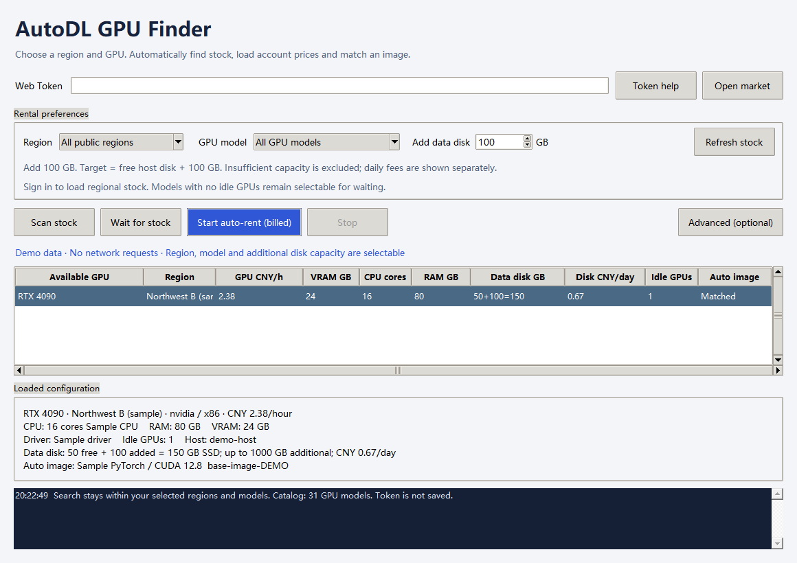

# AutoRent-autodl user guide

**English** | [简体中文](usage.md) · [English overview](README.en.md)

AutoRent-autodl runs locally on Windows with Python 3.10+ and tkinter. It uses the standard library and does not operate on your existing remote training instances.

Select a region, GPU model and additional disk capacity. The tool loads matching hosts, current account prices, CPU/RAM/VRAM, driver information, data disks and compatible images. Use **Advanced (optional)** for multiple regions/models, price caps or image overrides.



## Launch and sign in

```powershell
git clone https://github.com/VinceTree/AutoRent-autodl.git
cd AutoRent-autodl
.\start.cmd -Lang en
```

- **Language switch:** click **中文 | en** at the top of the window. Your Token, preferences, results and active search stay in place; open advanced preferences switch too. New sessions default to Chinese unless started with `-Lang en`.
- **English:** `start.cmd -Lang en`. **Chinese:** `start.cmd -Lang zh`; double-clicking `start.cmd` also defaults to Chinese.
- **Read-only:** `start.cmd -Lang en -ReadOnly`. The transport blocks creation, payment, power changes and release operations.
- **Offline demo:** `start.cmd -Lang en -Demo`. Uses sample data and sends no network requests.
- **Web Token:** sign in to AutoDL, press F12, open **Application → Local Storage → https://www.autodl.com → token**, and paste the value into the local tool. The Token stays in window memory and is not saved. Do not put it in source code, chat or command history.

Use the web session Token, not a developer/Pro API Token. Opening the window does not place an order. Only clicking **Start auto-rent (billed)** starts paid creation.

The main window, advanced preferences, CLI help and local status/error messages support English. Official region names, GPU model identifiers and platform-provided metadata retain their original values. Unrecognized server messages may also retain their original language.

## Regions and models

The region and GPU dropdowns control scanning, waiting and renting. Changing region refreshes that region's idle/total counts. Models with zero idle GPUs remain selectable so you can wait for them.

Your selected model is retained when switching region. If it is unavailable there, the tool shows **not offered in this region** and keeps the restriction. It never silently switches to another region or GPU. Previous host rows are cleared, and late responses from an old region/login are ignored.

The bundled catalog currently contains 33 compute products, including two CPU products, and 10 region groups. **All GPU models** excludes CPU unless explicitly selected in advanced preferences. Refreshing the public catalog loads later additions.

| Official region name | English reference | Physical room codes |
| --- | --- | --- |
| 西北B区 | Northwest B | `west-B`, `west-C`, `west-D`, `west-E` |
| 北京B区 | Beijing B | `bj-B1`, `bj-B2`, `bj-B3` |
| 重庆A区 | Chongqing A | `cq-A1` |
| 内蒙B区 | Inner Mongolia B | `nm-B1`, `nm-B2` |
| 北京A区 | Beijing A | `beijing-A`, `beijing-B`, `beijing-D`, `beijing-E` |
| 佛山区 | Foshan | `foshan-A` |
| V100专区 | V100 zone | `beijing-C` |
| A800专区 | A800 zone | `nm-A1` |
| 摩尔线程专区 | Moore Threads zone | `sh-A1` |
| 西北企业区 | Northwest enterprise | `west-X`; account permission required |

**All public regions** includes public special zones and excludes the enterprise region. A region can contain multiple physical rooms; the tool expands the complete mapping and checks returned hosts again locally.

In advanced preferences, regions and GPU models can be combined. The order in which you select them can define priority. Search text only filters the visible list. Clearing a selection requires choosing again and does not turn it into an unrestricted request.

The bundled snapshot is `autodl_quick/data/market-catalog.json`. Refreshed catalogs go to `.state/market-catalog.json`; the source snapshot is not modified during normal use.

## Scan, wait and rent

1. Paste your web Token and choose the accepted region/model. Leave the corresponding **All** option only when you want an unrestricted selection.
2. Enter additional data disk GB if needed. Prices, hardware and images load automatically.
3. **Scan stock** queries matching hosts. **Wait for stock** repeats until a match is found, then stops without creating an instance.
4. **Start auto-rent (billed)** searches only your selected scope, rents one single-GPU pay-as-you-go instance and stops after success. Region/model/disk controls are locked during a run. Stop the current task before changing them.

No stock means waiting; it does not relax the region, model, VRAM or disk requirement. The waiting limit controls how long the search runs, not the lifetime of a rented instance. There is no automatic shutdown timer; manage a successful rental in the AutoDL console.

Waiting and auto-rent share an adaptive schedule, with a **10-minute** waiting limit by default:

- Start immediately with the selected scope and loaded catalog. Use the explicit catalog refresh control before a run when you need updated region mappings.
- Query host pages directly while waiting; a lagging regional summary showing zero does not block a probe. Pages are requested in descending idle-count order; a full page explicitly showing zero idle GPUs ends that probe without scanning the busy tail. A one-off stock scan still uses the summary to narrow its query.
- The default fast interval is **1 second** for the first 20 seconds and for 20 seconds after finding candidates. With no candidates, it slows to about **3 seconds**. Positive jitter of 0–10% avoids a fixed beat. Query time counts toward the interval; rounds remain sequential and missed ticks are never replayed.
- Check images and online status, then obtain one final account quote before submitting. Continue immediately to the next candidate when a host is offline, incompatible, too expensive or explicitly out of stock. An explicit stock rejection gives that host a 10-second cooldown before it can be tried again.
- Reads during waiting have a timeout of at most 5 seconds, shortened near the deadline. The waiting loop owns retries, using roughly 2, 4, 8, 16, 32 and 60 seconds of backoff and respecting HTTP `Retry-After`. Cancellation interrupts the wait; in-flight reads remain subject to their timeout. An uncertain create still stops without retrying.

Adjust the base interval in **Advanced preferences**; fractional values are supported, with a **0.5-second** minimum. Idle polling uses three times the base, capped at 30 seconds, without going faster than your chosen base. Saved intervals remain effective; change an old 3-second setting to 1 second if desired. The `polls` list in `.state/runs/` reports query duration, next wait, candidate count and consecutive read failures.

Advanced preferences provide three ordering strategies:

- **First available page; lower price first:** process idle-first pages as they arrive and check cheaper hosts within each page. This does not guarantee the lowest price across the whole market.
- **GPU selection order:** search selected models in order.
- **Region selection order:** search selected regions in order, including all their mapped rooms.

Leave the GPU hourly cap blank to use the current account quote. Disk daily fees are displayed separately and are not part of this hourly GPU cap.

## Data disk expansion

- **Add data disk** is the **additional** capacity in GB; `0` means no expansion. If the host provides 50 GB free and you enter 100, the target data disk is 150 GB.
- Capacity is checked using the host's `max_data_disk_expand_size`. Hosts with insufficient or unknown expansion capacity are excluded when expansion is requested.
- The same size is used for filtering, quoting and creation. The `expand_data_disk` fields in both order sections are submitted as `GB × 1024³` bytes.
- GPU quotes are shown in **CNY/hour** and data disk fees in **CNY/day**. The disk fee comes from the account quote's `data_disk_info.data_disk_deal_daily_price / 1000`; missing or invalid fees block creation.
- Paid disks are billed separately per day and may continue charging while the instance is off. Reduce the paid capacity or release the instance in AutoDL when no longer needed. See [data disk documentation](https://www.autodl.com/docs/local_disk/) and [billing rules](https://www.autodl.com/docs/price/).

## Image matching and configuration

NVIDIA/CUDA, Moore Threads/MUSA and CPU profiles are separate. Per-model image overrides take priority over platform profiles. Automatic selection loads the image catalog and prefers PyTorch, checking vendor, CPU architecture, GPU family and driver/runtime compatibility.

Blackwell GPUs require CUDA 12.8 or newer. The automatic policy selects CUDA 12.6 or earlier for older Volta/Pascal GPUs such as V100 and 1080 Ti, avoiding unsupported newer builds. Moore Threads and CPU do not inherit NVIDIA CUDA requirements. Framework/operator compatibility still needs validation inside the resulting instance. References: [NVIDIA CUDA 13 release notes](https://docs.nvidia.com/cuda/archive/13.0.0/cuda-toolkit-release-notes/) and [PyTorch Volta support discussion](https://dev-discuss.pytorch.org/t/dropping-volta-support-from-cuda-12-8-binaries-for-release-2-11/3290).

If no compatible image is found, real creation is skipped. You do not need to type an image UUID unless you want an override.

**Save preferences** in the advanced window writes non-sensitive options to root `config.json`, including region/model/disk choices, waiting limits and image profiles. It does not save the Token. For manual setup, copy `config/config.example.json` to root `config.json`; this is optional.

Local configuration and `.state/rental.json` retain their original paths across source reorganizations, so existing rental records remain effective.

## Quotes and duplicate prevention

Quotes use one GPU, pay-as-you-go billing and your selected disk expansion. The hourly instance price prefers positive `payg_price / 1000`; an unused `deal_price = 0` placeholder is not treated as a free GPU. The final account quote and optional GPU cap are checked after the online check, immediately before submission. The platform bill remains authoritative because availability and prices can change between preview and creation.

An OS-level lock prevents concurrent rental processes. A durable submitting record is written to `.state/rental.json` before sending a create request; a successful response adds the instance ID. Passwords, Jupyter tokens and the web Token are not written to this record.

- Explicit `NoStock`, `GPUNotEnough` or `GpuNotEnough` responses permit trying another host. This fallback has been tested with simulated creation.
- A create timeout, unclear response or other business rejection stops the run and retains its record. Creation is never retried blindly.
- Temporary read failures may be retried within the main window's waiting limit. Expired login or unrecognized responses stop the run. The advanced legacy wait flow stops after five consecutive read failures.
- Failures display the specific reason in the main window. Rental records retain the creation error type, platform error code or HTTP status. Individual reports in `.state/runs/` preserve earlier failures after another click. A blocked retry also includes the previous failure reason.
- An existing successful or uncertain record blocks another rental. After checking the console, use `python -m autodl_quick archive-state --checked-console --lang en` if you intentionally want to rent another instance. Archiving neither shuts down nor releases an instance.

## CLI and tests

Commands run from the repository root. Unless `AUTODL_WEB_TOKEN` is provided in the local environment, the CLI prompts for hidden Token input. Keep credentials out of command history.

```powershell
# Offline tests: all paid creation and network calls are mocked
python -m unittest discover -s tests -v

# Offline English interface
python -m autodl_quick gui --demo --lang en

# Public catalog refresh, no Token required
python -m autodl_quick catalog --lang en

# Read-only, exact GPU models and public region IDs
python -m autodl_quick scan --read-only --lang en --gpus "RTX 5090,RTX 4090" --regions "beijingDC2,westDC3"

# Require room for 100 GB additional disk; no instance is created
python -m autodl_quick scan --read-only --lang en --gpus "RTX 5090" --regions "westDC3" --expand-disk 100

# Wait for a matching GPU, query only
python -m autodl_quick watch --read-only --lang en

# List Moore Threads images
python -m autodl_quick images --read-only --image-platform mthreads --lang en

# Paid: run only when you intend to create one instance
python -m autodl_quick rent --execute --lang en
```

Tests cover exact GPU names, complete room mappings, stale inventory responses, disk capacity and units, separate daily fees, image matching, cancellation, concurrency, explicit no-stock fallback and uncertain creation. Local authenticated verification used read-only stock and quote endpoints; it did not submit paid creation for testing.

`config.json`, `.state/`, `.research/`, local reports and caches are excluded from Git. Screenshots use offline demonstration data without real credentials or rental records.

## API sources

This tool uses the regular market web client's endpoints, not the separate [Pro developer API](https://www.autodl.com/docs/instance_pro_api/). It does not bypass login, verification or account restrictions.

| Purpose | Endpoint |
| --- | --- |
| Public regions and GPU models | `GET /api/v1/region/list`, `GET /api/v1/machine/gpu_type` |
| Regional model counts | `POST /api/v1/machine/region/gpu_type` |
| Hosts and account quotes | `POST /api/v1/user/machine/list`, `POST /api/v1/order/price/preview` |
| Images and host status | `POST /api/v1/image/all`, `POST /api/v1/machine/check_machine_online` |
| Creation and SSH metadata | `POST /api/v1/order/instance/create/payg`, `GET /api/v1/instance/snapshot` |

Implementation references: [official web services](https://www.autodl.com/assets/service-code.30826265.js), [region mapping](https://www.autodl.com/assets/utils.3f8cc83b.js) and [order parameters](https://www.autodl.com/assets/index.9040cb9d.js). Web endpoints and asset URLs can change; unrecognized formats stop the tool rather than guessing prices or creation outcomes.
