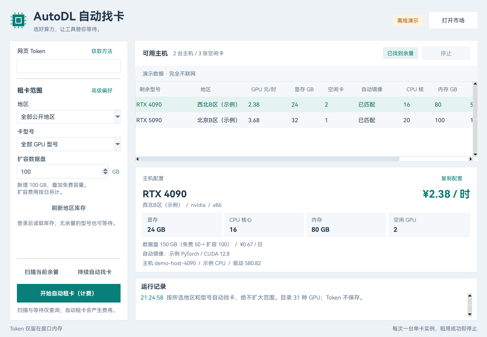

# AutoRent-autodl 使用说明

[English](usage.en.md) | **简体中文** · [项目首页](../README.md)

一个在本地运行的 AutoDL 自动租卡小工具，支持按地区、型号和数据盘扩容需求等待余卡。

运行在本地 Windows，Python 3.10+，不需要安装第三方库。Codex、网页登录凭据和 API 请求都留在本机；本项目不操作已有远程训练实例。

在主界面粘贴本地网页登录 Token，选择**地区**、**卡型号**与**扩容筛选（新增容量）**，然后点击“扫描当前余量”“持续自动找卡”或自动租卡按钮。填写正数扩容容量时，租卡按钮会显示“按扩容条件抢卡（计费）”。工具只在该范围内找卡，自动读取账户当前价、CPU、内存、显存、驱动、数据盘与兼容镜像；不需要手填价格或镜像。也可保留“全部公开地区 / 全部 GPU 型号”扫描全市场。多地区、多型号、价格上限和特殊镜像通过“高级偏好”设置。



```powershell
git clone https://github.com/VinceTree/AutoRent-autodl.git
cd AutoRent-autodl
.\start.cmd
```

## 打开与登录

- 窗口顶部“中文 | en”：即时切换界面语言，保留 Token、筛选条件、查询结果和正在进行的任务；高级偏好窗口同步切换。重新打开默认中文，除非启动时指定 `-Lang en`。
- `scripts/start-readonly.cmd`：只读测试，网络层禁止创建、支付、开关机、释放实例。
- `start.cmd`：正常窗口，显示独立的“开始自动租卡（计费）”按钮；打开窗口不会自动下单。
- `start.cmd -Lang en`：英文界面；`start.cmd -Lang zh`：中文界面。只读与演示开关可组合，例如 `start.cmd -Lang en -ReadOnly`。命令行同样支持 `--lang en`。地区名称和型号标识保持官网原名，不翻译 API 参数。
- 网页 Token：登录 AutoDL → F12 → Application / 应用 → Local Storage / 本地存储 → `https://www.autodl.com` → `token`。只粘贴到本地工具，不发到聊天。Token 只保存在窗口内存，关闭后需重新填写。

## 型号与地区

主界面的地区、卡型号下拉框直接决定扫描、等待和自动租卡的范围。选地区后自动刷新该地区的型号与“空闲 / 总量”，也可点击“刷新地区库存”。空闲为 0 的型号仍可选择，便于等待；切换地区后保留你已选定的型号，若新地区没有该型号会明确显示“本地区未提供”，不会自动扩大到其他型号。切换范围同时清掉旧主机列表；迟到的旧地区 / 旧登录库存不会覆盖当前选择。

需要多地区、多型号或优先顺序时，再打开“高级偏好”；应用后主界面会标明正在使用高级多选范围。以下勾选与搜索操作均在高级偏好窗口中完成。

“刷新官网目录”从 AutoDL 公共接口获取完整型号与地区映射，缓存到 `.state/market-catalog.json`；首次运行使用 `autodl_quick/data/market-catalog.json` 的内置快照。当前内置目录有 33 种算力型号（包含 2 种 CPU 产品）、10 个地区分组。目录是获取时的快照；之后新增的型号和地区通过刷新加载。

- 支持 NVIDIA、vGPU、摩尔线程、V100/A800 等专区型号，CPU 也可单独选择。
- “全部 GPU”包含全部 GPU 型号，不自动包含 CPU；“仅 NVIDIA”只勾选 NVIDIA GPU。
- 点击一项可切换选择；从“全部”状态点击某一型号 / 地区时，先切到只选该项，之后可继续多选。
- 型号勾选顺序和地区勾选顺序分别用于相应的优先策略。清空选择会要求重选，不会自动变成不限条件。
- 型号列表可滚动、搜索。筛选文字不改变已勾选的型号。

官网的地区名称与物理机房不是一对一。工具根据官网映射展开**整个地区**，同时对返回结果再次检查，防止 API 返回额外地区时误租：

| 官网地区 | 物理机房范围 |
| --- | --- |
| 西北B区 | west-B、west-C、west-D、west-E |
| 北京B区 | bj-B1、bj-B2、bj-B3 |
| 重庆A区 | cq-A1 |
| 内蒙B区 | nm-B1、nm-B2 |
| 北京A区 | beijing-A、beijing-B、beijing-D、beijing-E |
| 佛山区 | foshan-A |
| V100专区 | beijing-C |
| A800专区 | nm-A1 |
| 摩尔线程专区 | sh-A1 |
| 西北企业区 | west-X；需账户权限 |

“全部公开地区”包含普通地区和公开专区，默认不包含企业区。手动选择企业区仍受平台账户权限约束。

选择地区后刷新对应型号的“空闲 / 总量”。空闲为 0 的型号仍保留在列表，方便持续等待；切换地区后会清除旧地区计数，迟到的旧请求不会覆盖新地区结果。“本地区未提供”与“有型号但空闲为 0”分开显示。

## 等待与抢卡

1. 粘贴网页 Token，在主界面选择需要的地区与卡型号；需要不限范围时选择对应的“全部”。
2. 点击“扫描当前余量”或“持续自动找卡”，该范围内的主机、平台当前报价、硬件配置和镜像自动加载。
3. 默认只查询，命中后显示结果，不创建实例。持续找卡会在发现可用卡后停止。
4. 确实需要租卡时，在 `start.cmd` 打开的正常窗口点击“开始自动租卡（计费）”。它只在所选地区、型号和扩容条件中持续找卡，按平台当前价自动租用，成功后停止；每次只创建一台、单张卡、按量计费，数据盘按你填写的容量扩容。没余量时继续等，不擅自换地区、型号或减少扩容容量。运行期间锁定选择，需停止当前任务后再切换范围。只读窗口中的租卡按钮禁用。

等待与自动租卡共用自适应节奏，一次任务默认最多等待 **10 分钟**：

- **立即开始**：使用当前已加载的目录和所选范围，不先同步刷新公共目录；需要更新地区映射时，提前点击“刷新官网目录”。
- **直接查主机**：等待流程不以地区汇总库存为门槛，避免汇总仍为 0 时漏掉刚释放的卡。按空闲数降序查询，整页明确无卡时不再翻忙碌主机页。单次“扫描当前余量”仍使用汇总缩小查询范围。
- **快查与降频**：默认基础间隔 **1 秒**，启动后的 20 秒及发现候选主机后的 20 秒保持快查；持续无候选时降至约 **3 秒**。加入 0–10% 的正向随机偏移，避免固定节拍。间隔从每轮开始计时，扣除查询耗时，串行查询不重叠，也不补发错过的轮次。
- **命中立即尝试**：逐页检查，先匹配镜像、检查在线，再获取一次最终账户报价并提交；不为同一候选串行获取三次报价。首台不满足价格、镜像或在线条件时立即检查同页下一台。明确缺卡后立即换备选，并对该主机冷却 10 秒；冷却到期可以再次尝试。
- **失败退避**：等待期间单次读取超时上限为 5 秒（临近截止时进一步缩短），不再叠加接口内部三次重试；由等待流程统一退避，默认约 2、4、8、16、32、60 秒，并遵守 HTTP `Retry-After`。停止按钮可立即中断轮询等待，正在进行的网络读取受上述超时约束。付费创建仍只发一次，结果不确定就停止。

在“高级偏好”中调整“间隔 秒”和“最长等待 分钟”；基础间隔支持小数，最小 **0.5 秒**。无候选时使用基础间隔的 3 倍，最高降频到 30 秒，但不会快于你设置的基础间隔。已有保存的间隔继续生效，旧配置如为 3 秒，可手动调为 1 秒。`.state/runs/` 的 `polls` 记录每轮查询耗时、下一次等待、候选数和连续读取失败次数，便于检查实际节奏。

三种排序策略：

- **先发现可用卡，页内低价优先**：请求空闲数优先排列的分页，一页返回就检查，不等整个市场查完。这是为了尽早尝试可用主机，不能承诺全市场绝对最低价。
- **按型号勾选顺序**：依次查询所选型号，优先尝试排在前面的型号。
- **按地区勾选顺序**：依次查询所选官网地区，每次覆盖该地区的所有物理机房。

价格上限留空即按平台当前报价，无需填写。等待时限与实例运行时长不同，工具没有自动关机定时器。租用成功后会停止租卡；实例持续计费，需在控制台关机。

## 数据盘扩容与筛选

- 主界面的“扩容筛选（新增容量）”填写**新增容量**，单位 GB，0 表示不扩容。例如主机免费数据盘 50 GB，填写 100，创建后的目标数据盘为 150 GB。
- 填写正数后，租卡按钮显示“按扩容条件抢卡（计费）”。点击后持续等待同时满足地区、型号与扩容容量的主机；即使 GPU 有空闲，只要扩容余量不足或未知，就跳过并继续查下一台、下一页或下一轮，不降低容量要求。空结果提示与等待日志会显示正在等待的新增 GB。命中后实际扩容所填容量，成功租用一台后停止。只读的“持续自动找卡”也使用相同容量条件。
- 按官网的 `max_data_disk_expand_size` 判断当前可扩容量；请求增加 100 GB 时，扩容余量不足 100 GB 或容量信息缺失的主机会被跳过。主机的免费数据盘与可扩容量分开显示，不把两者混淆。
- 扫描、等待和自动租卡使用同一份扩容条件；报价与创建的两个 `expand_data_disk` 字段均按 `GB × 1024³` 提交，不会只过滤而漏掉实际扩容。
- 列表与详情分别显示 GPU **元/小时**和数据盘**元/日**。日费读取平台当前账户报价 `data_disk_info.data_disk_deal_daily_price / 1000`，未取得有效报价就停止，不假设免费。高级偏好的“最高价 元/时”约束 GPU 实例小时价，数据盘日费独立显示。
- 数据盘按日单独结算，**关机后仍可能产生数据盘费用**；无需付费数据盘时应在官网缩容或释放实例。详见 [AutoDL 数据盘说明](https://www.autodl.com/docs/local_disk/)与[计费规则](https://www.autodl.com/docs/price/)。

## 镜像匹配

- NVIDIA / CUDA、摩尔线程 / MUSA、CPU 分别保存平台通用镜像。切换平台不会丢失其他平台的配置。
- “型号专用镜像”可为某个型号单独配置，例如给 V100 配旧 CUDA 镜像，给 5090 配新镜像。型号专用配置优先于平台通用配置。
- 库存查询不再强制所有卡支持 CUDA 12.8，避免漏掉 V100、1080 Ti 或摩尔线程。
- 实际租用时检查平台、CPU 架构与 NVIDIA 主机支持的 CUDA 版本。Blackwell 型号要求 CUDA 12.8 或更新镜像；普通型号按实际镜像版本与主机驱动比较。摩尔线程、CPU 不套用 NVIDIA CUDA 条件。
- 默认自动读取该平台镜像目录并挑选可用镜像，优先 PyTorch；按平台、架构、GPU 类型和主机驱动匹配。不需要手填镜像 UUID。无法匹配时会显示出来并跳过真实创建，不会拿 NVIDIA 镜像去创建摩尔线程实例。镜像内框架对任务算子的支持仍需在实例中验证。
- V100、1080 Ti 等 Volta / Pascal 老架构自动选择 CUDA 12.6 或更早的镜像，避免误选 CUDA 13。依据：[NVIDIA CUDA 13 移除旧架构支持](https://docs.nvidia.com/cuda/archive/13.0.0/cuda-toolkit-release-notes/)、[PyTorch 旧架构构建说明](https://dev-discuss.pytorch.org/t/dropping-volta-support-from-cuda-12-8-binaries-for-release-2-11/3290)。

“保存条件”保存非敏感配置到 `config.json`：型号、地区、价格、等待条件、各平台及型号专用镜像，不包含 Token。

配置示例放在 `config/config.example.json`。确实需要手工配置时，可复制到仓库根目录并命名为 `config.json`；不复制也能通过界面直接使用。`config.json` 和运行记录仍使用原来的根目录路径，整理源码不会绕过已有的防重复租用记录。

## 报价与防重复

报价自动读取单卡、按量与所选扩容容量的账户当前成交价，包括平台会员折扣；GPU 按量价优先采用 `payg_price / 1000`，数据盘另读取日费。`deal_price` 的 0 占位值不会当作免费价格；需要时再采用正值成交价、折扣明细或原价。不要求用户手填价格。最终账户报价与可选 GPU 小时价上限在在线检查之后、提交之前核对。网页 API 没有公开服务端硬性价格上限，报价到创建之间仍有短暂竞态，以平台账单为准。

使用操作系统进程锁防止多个窗口同时租卡，发送创建前先把提交记录写入 `.state/rental.json`，成功后写入实例 ID。记录不含 Token、SSH 密码或 Jupyter Token。

- 平台明确返回 `NoStock`、`GPUNotEnough` 或 `GpuNotEnough` 时，记录为已拒绝并尝试下一台；该分支只通过模拟测试，尚未为验证它而发送真实创建请求。
- 创建超时、响应不明或其他业务错误时立即停止并保留记录，不自动重发，避免重复租用。
- 失败时主界面直接显示具体原因；创建错误类型、平台错误码或 HTTP 状态保存在租卡记录中。每次任务的独立报告保留在 `.state/runs/`，后续点击不会覆盖首次失败的报告。再次租卡被拦截时也会带出上次失败原因。
- 主界面会在设定的等待时限内重试暂时的查询网络失败；登录失效或响应格式异常会停止。高级界面原有等待流程在连续 5 次查询失败后停止。可修复网络 / 登录后重新等待。
- 已有成功或不确定提交记录时拒绝再次租卡。核对控制台后，需要另一台时运行 `python -m autodl_quick archive-state --checked-console` 归档本地记录；归档不关机、不释放实例。

## 命令行与测试

未设置环境变量时会在本机隐蔽输入 Token；也可由本地会话提供 `AUTODL_WEB_TOKEN`，不要把 Token 写进代码或命令历史。

```powershell
# 离线测试：网络、库存、创建全部模拟
python -m unittest discover -s tests -v

# 界面演示，完全不联网
python -m autodl_quick gui --demo

# 刷新公共型号与地区目录，不需要 Token
python -m autodl_quick catalog

# 只读：查询北京B区与西北B区，接受三种型号
python -m autodl_quick scan --read-only --gpus "RTX 5090,RTX 4090,RTX 3090" --regions "北京B区,西北B区"

# 只读：筛选能够额外扩容 100 GB 的主机，并加载数据盘日费
python -m autodl_quick scan --read-only --gpus "RTX 5090" --regions "西北B区" --expand-disk 100

# 只读：自动等全市场剩余 GPU，自动加载信息，不下单
python -m autodl_quick watch --read-only

# 读取相应平台镜像
python -m autodl_quick images --read-only --image-platform mthreads

# 未来确实租卡时才运行；全市场自动找卡并匹配镜像，按平台当前价
python -m autodl_quick rent --execute
```

离线与界面回归共 196 项，覆盖型号精确匹配、CPU 明确选择、最低显存、完整地区机房映射、地区边界、地区切换旧响应、镜像平台与型号分流、逐页提前命中、缺卡后备选、涨价、断网、取消、并发、不确定创建不重试，以及快查 / 降频、冷却到期、限流退避和请求截止时间。扩容回归还验证容量不足或未知时跨页、跨轮继续等待，容量恢复后实际扩容，及备选主机和语言切换保留扩容条件。

2026-10-31（北京时间）在用户授权下完成一次真实租赁验证：使用仓库的 `Engine.auto_wait`，在原有筛选范围内租到北京B区单张 RTX 4090，账户报价 2.18 元/小时，不扩容数据盘。从开始查询到发送创建约 0.97 秒，收到实例 ID 约 1.18 秒，提交前共 4 次读取；计时不含从 Chrome 读取本地登录信息。随后确认实例进入 `running`，测试清理发送关机并确认 `shutdown`。全程仅发送 1 次创建请求：2 次前置只读检查，加上租用、定时关机兜底、状态检查与关机共 12 次请求；没有进行高频压力测试。原有实例状态与全局租卡记录均保持原样。本地证据为 `.state/preflight-v2.json` 和 `.state/live-smoke-v2.json`，不含 Token。明确缺卡后的回退分支仍由离线模拟验证。

2026-10-25 19:10（北京时间）已完成默认自动模式的登录后只读联调：无需指定型号、地区、价格或镜像，自动加载了 12 台有余量主机及配置。结果和请求审计见 `.state/auto-finder-query.json`，不含 Token；这是该次查询的快照，不代表当前库存。此前分地区验证见 `.state/multi-market-verification.json`，高级筛选查询见 `.state/inventory-query.json`。当日验证均未提交付费创建。

2026-10-25 19:26（北京时间）地区 / 型号选择版本完成三组真实库存查询：西北B区 / RTX 5090、北京B区 / RTX 5090、摩尔线程专区 / MTT S4000。请求使用各地区的完整物理机房范围，且全部只读；结果见 `.state/region-model-selector-verification.json`。离线与界面测试共 103 项通过，包括误返地区 / 型号过滤、0 库存不放宽范围、切地区清理旧结果和运行期间锁定选择。租用按钮流程使用模拟创建验证，本次未实际下单。

扩容版本共 120 项测试通过，覆盖容量不足、容量信息缺失、GB / 字节换算、独立日费、自动镜像后保留扩容、最终报价与创建容量一致、主界面与高级偏好同步。2026-10-25 的真实只读报价验证见本地 `.state/disk-expansion-verification.json`；没有为测试发送付费创建。

`.state/`、`.research/`、`config.json`、本地测试报告和缓存均不提交到仓库。界面图片为演示数据，不含真实登录凭据或租卡记录。

## 接口来源

复用普通算力市场网页使用的接口，不使用另一套[官方 Pro 开发者 API](https://www.autodl.com/docs/instance_pro_api/)的 Token，也不绕过平台登录、认证、验证码或账户限制。

| 功能 | 接口 |
| --- | --- |
| 地区目录与型号目录 | `GET /api/v1/region/list`、`GET /api/v1/machine/gpu_type` |
| 已选地区型号库存 | `POST /api/v1/machine/region/gpu_type` |
| 主机库存与报价 | `POST /api/v1/user/machine/list`、`POST /api/v1/order/price/preview` |
| 镜像、在线检查 | `POST /api/v1/image/all`、`POST /api/v1/machine/check_machine_online` |
| 创建与 SSH 信息 | `POST /api/v1/order/instance/create/payg`、`GET /api/v1/instance/snapshot` |

依据：[官网 API 方法](https://www.autodl.com/assets/service-code.30826265.js)、[官网地区筛选](https://www.autodl.com/assets/utils.3f8cc83b.js)、[下单参数](https://www.autodl.com/assets/index.9040cb9d.js)。网页接口和脚本地址可能随官网更新变化；格式不明时工具停止或显示未刷新，不猜测价格和创建结果。
